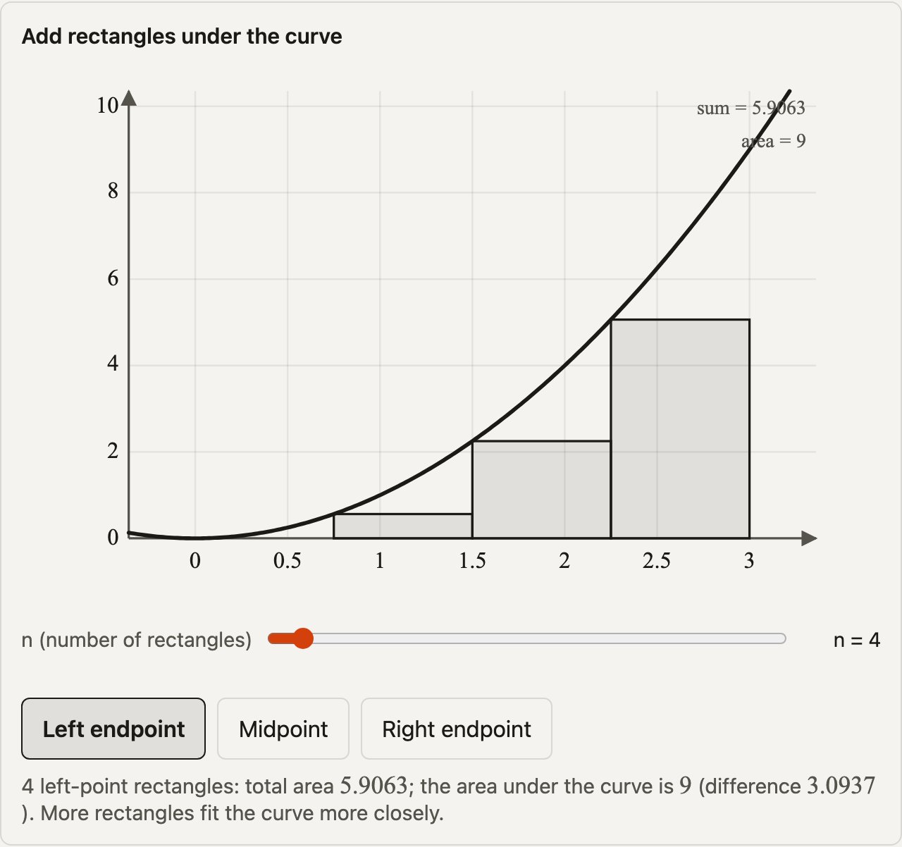
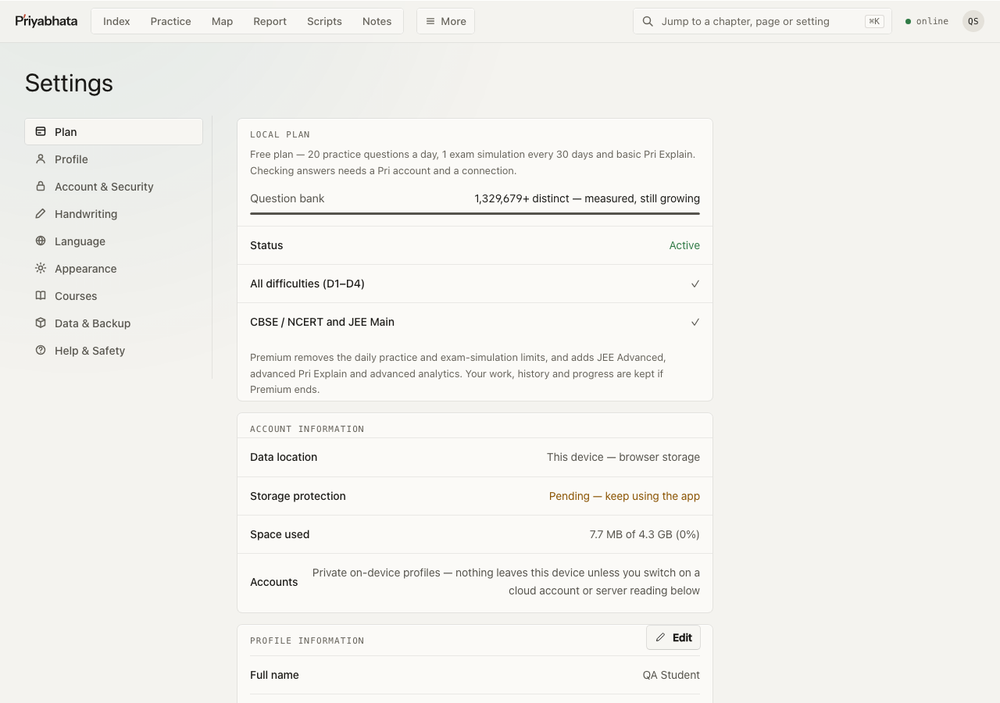
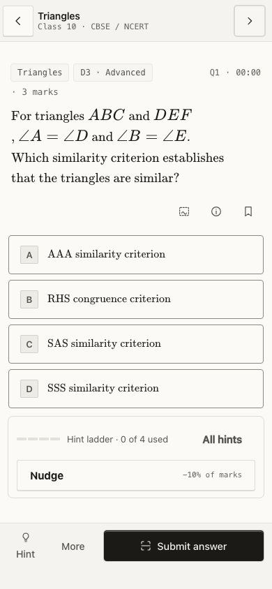
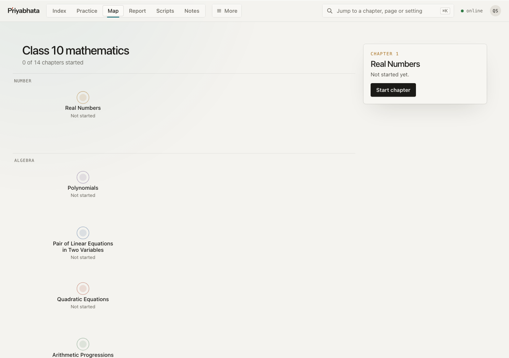
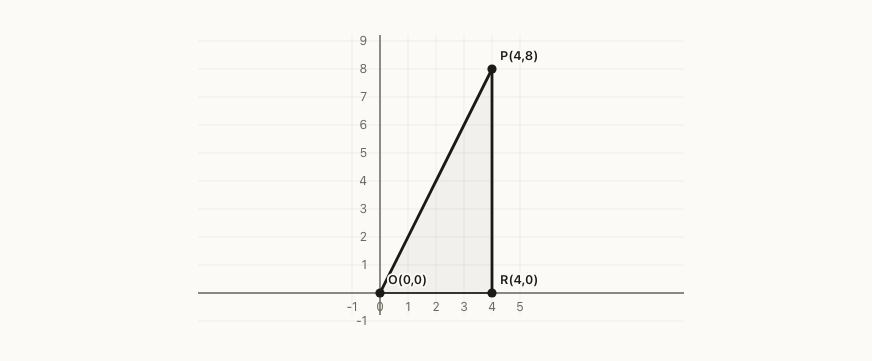
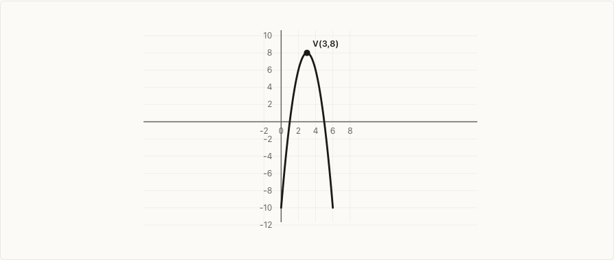
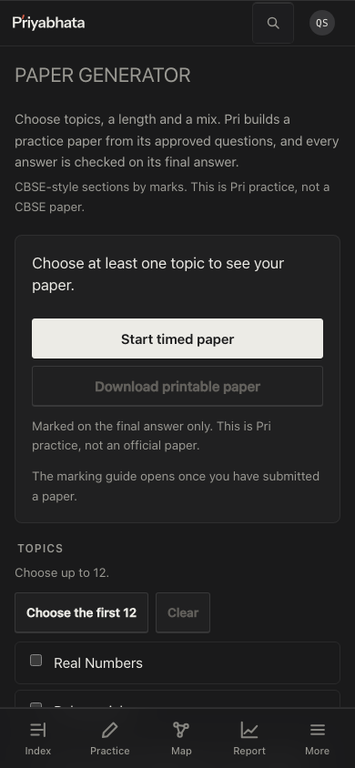

# Quality audit, cycle 1 (2026-11-18)

**What was rendered.** An integration build (train-editions-23 + the diagram kit #952 + the NSW notes content from #966) served by the real test platform, signed in as a Class 10 India student, in Chromium. Scripts: `qa-notes.mjs` (all 13 Class 12 Notes chapters, figure crops, KaTeX/Unicode/overlap assertions), `qa-screens.mjs` (13 routes × desktop/phone × light/dark), `qa-riemann.mjs` (the diagram kit's Riemann widget). Raw output: `notes-sweep.json`, `screens-sweep.json`. Full screenshots are regenerated by the scripts and are not committed; crops are in `crops/`.

**Not covered this cycle (say so plainly).** The Prithagoras (NSW) edition was not rendered: the verified-onboarding harness only creates India accounts (`course !== 'in'` throws), so NSW notes, edition leakage and the AU sign-in need a harness change first (idea 5). Only Class 12 chapters were swept (the Notes index lists one class at a time). Sign-in, Exam Desk and a 5-question-per-topic sample were not rendered. Contrast and focus were checked structurally only, not measured.

## Findings, ranked

### 1. Riemann widget: axes do not meet at (0, 0), and the sum/area labels sit on the curve. (accuracy + formatting) — **for lane diagram-kit (#952)**

- The y-axis is drawn at the frame's left edge (`x1=x2=44` in the SVG), not at x = 0. `riemannModel` pads the frame to `a − 12 %` (`geometry.js`, `xmin: a - (b - a) * 0.12`), and `RiemannRectangles` (`Diagram.jsx`) draws the vertical axis at `f.left`. With a = 0, the curve's vertex (0, 0) is visibly left of the axis; the owner's reported case.
- The y tick labels (`0, 2, … 10`) hang off the frame edge, so the "0" on the y-axis and the "0" on the x-axis are different points.
- `sum = …` and `area = …` are pinned top-right (`f.right − 6, f.top + 10/30`), exactly where an increasing curve exits the frame, so the curve strikes through both labels. Same in the owner's n = 4 screenshot (`sum = 14`, `area = 21.3333`).
- The curve is drawn past x = b to `frame.xmax` and off the top of the frame.
- Readout line: ")." wraps alone onto a second line (finding 3).
- Suggested fix: draw the y-axis at `f.sx(0)` when `frame.xmin < 0 < frame.xmax` (else at `f.left`), put y tick labels at that x, move the sum/area labels to the top-left of the plot (or into the readout only, which already says both), and add a geometry check "the y-axis x equals `sx(0)` whenever 0 is inside the frame" to `diagram-geometry-check.mjs`. The numbers themselves are right (n = 4 left, x² on [0, 4]: 0+1+4+9 = 14; exact 64/3 = 21.3333; difference 7.3333).

### 2. Unicode tick marks in Settings. (copy/design rule) — fixed here

`SettingsLegacy.jsx` lines 505–506 render `✓` for "All difficulties" and "CBSE / NCERT and JEE Main". The approved rules ban Unicode tick icons. Fixed in this PR by showing the existing `settings.active` word instead (no new string, so the examiner dossier digest is untouched).

### 3. Punctuation after inline maths wraps onto its own line. (formatting) — shared `MathText`; **for the lane that owns it**

On a 390 px phone the Class 10 similarity question reads "For triangles ABC and DEF" then a new line starting ", ∠A = ∠D …"; the "· 3 marks" chip text also orphans onto its own line. Same cause in the Riemann readout (")." alone). A break is being allowed between a KaTeX inline box and the punctuation that follows it. Fix in `MathText`: wrap each math span together with a directly following punctuation run in one `white-space: nowrap` element (or insert a U+2060 word joiner before it). Add a regression test that renders a question ending a clause with math on a 390 px viewport and asserts no line begins with `, ; . )`.

### 4. Map is a single narrow column at 1280 px and shows no prerequisite lines for a new student. (UX)

Class 10 chapters stack in one column at the far left with roughly 70 % of the width empty, and 200 px gaps between nodes; the layered prerequisite lines from #944 are not visible. Either the layout falls back to a list at this width, or edges only appear after progress. Needs a look by whoever owns #944 (it is in train 23 already).

### 5. Origin clutter on coordinate figures. (formatting) — India Class 12 notes figure

`O(0,0)` collides with the tick "0" and the axis; the x-axis "−1" and the y-axis "−1" stack on top of each other under the origin. Suppress the "0" tick and nudge the point label away from the axes when a labelled point sits at the origin (`StudyDiagram` / `Axes`).

### 6. Parabola figures are off-centre with an arbitrary x-window. (formatting)

`y = −2x² + 12x − 10` draws x from 0 to 6 inside a window that runs about 6 units left of the y-axis and 2 right of the curve; the curve is cut by the frame at y = −10 rather than showing its full branch. Centre the window on the vertex and intercepts.

### 7. Unicode superscripts in ~230 plain-text strings in India notes data. (copy/design rule)
`notes-sweep.json` lists them: worked-example questions (e.g. "Let f(x)=(x²-4)/(x-2) …"), quiz options, and sr-only diagram text, across `client/src/notes/data/notes-{expansion,challenges}-class{7..12}.js` and `notes-advanced-complex.js`. The rule bans Unicode superscripts, and they typeset differently from the KaTeX used for every other formula on the same page. A mechanical codemod to `$x^{2}$` is possible, but each worked example is checked against the engine, so it should be done as one reviewed mission with `npm run test:notes`. Not done here; no other lane is editing these files today.

### 8. Paper generator, phone dark: the page title is dimmer than the body text. (accessibility/hierarchy)

"PAPER GENERATOR" is mid-grey while the paragraph below it is near-white, so the heading reads as disabled. Checkboxes sit above the label baseline ("Real Numbers"). Check heading colour token in dark and align the checkbox/label.

### 9. "Show solution" button has no visible or accessible text on phone. — needs confirmation
The sweep found a `<button class="btn btn-quiet" aria-live="polite">Show solution</button>` whose rendered text is empty on a 390 px viewport (practice, both themes). It may be hidden until an answer is submitted; verify that no empty focusable button is reachable by keyboard or screen reader.

## For lane X (relay by the CTO)
- **diagram-kit (#952):** finding 1 (axis at x = 0, label placement, geometry check). Also finding 5/6 if those figures come from the kit.
- **whoever owns `MathText`:** finding 3.
- **map (#944, already in train 23):** finding 4.

## Ideas (beyond bug fixes)
1. **A "figure contract" test**: for every kit diagram, assert from the model that the axes cross at the data origin, no label rectangle intersects a curve segment, and every printed number equals the value computed from the spec. Catches finding 1 and its relatives before a human does.
2. **Show the arithmetic behind the Riemann readout**: list the n heights and widths in a collapsed "Show the sum" row (`0 + 1 + 4 + 9 = 14`), so a student can verify the 14 rather than trust it.
3. **One origin convention for every figure**: a single shared axes helper (origin tick suppressed, point labels nudged) used by Notes figures and the kit, so notes and kit figures look like one instrument.
4. **Render-QA as a lane check**: run `qa-notes.mjs`-style assertions (KaTeX errors, Unicode superscripts, orphaned punctuation, label overlap) on a PR's changed chapters in the lane's local checks, not only in the auditor's pass.
5. **Edition-aware QA harness**: let `createVerifiedProfile` create an NSW account on a Prithagoras build so the same sweeps cover NSW notes, edition leakage and the AU sign-in. Today that edition is unaudited.
